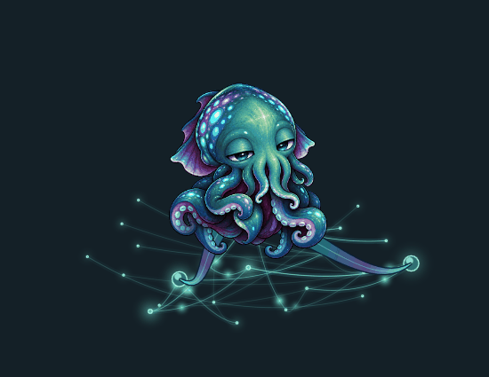

# Terminus

A small cuttlefish who lives on your desktop and minds his own business. Mostly.



He naps on a glowing graph, reaches toward things that hold his attention, and sometimes wanders off to inspect a corner of the screen. Carry him around and he swims. His skin shifts through shimmer, moving bands of color, camouflage and a deep red display. He occasionally leaves a few signs in a made-up language.

There is a little learning behind it. Repeated events become familiar. A small recurrent model learns short event patterns, and connections in the graph influence where his attention goes. He keeps that history between runs. The animations give those changes a body.

## Install

Linux and macOS, Python 3.10 or newer, and [uv](https://docs.astral.sh/uv/getting-started/installation/). No GPU, model download or cloud inference account is needed.

```sh
git clone https://github.com/Esemianczuk/Terminus.git
cd Terminus
uv run python scripts/setup.py
```

The installer builds a local environment, starts his core and desktop body, sets up login startup and recovery, and adds **Bring Back Terminus** to your desktop. On macOS it is an app with his picture. On Linux it is a desktop launcher.

To try him before installing services:

```sh
uv sync --frozen --extra desktop
# First terminal:
uv run python -m terminus serve
# Second terminal:
uv run python desktop/overlay.py
```

The desktop needs a logged-in graphical session. macOS uses launch agents; Linux uses systemd user services. X11 has window-position awareness and occasional typing imitation. Those observers are not available on macOS or native Wayland yet. The creature, learning, animation and color effects work without them. Other devices can use the browser habitat.

## Living with him

Click to give him a nudge. Drag to carry him. Right-click for size, movement, facing and skin controls. Empty space around him lets clicks pass through to your other windows.

**Bring Back Terminus** checks both services and restores him if needed. Background checks also recover stopped or frozen processes. An explicit Quit or stop is respected until you bring him back or sign in again.

The graph shows memory contexts and their associations. Brighter nodes are active; stronger connections draw more clearly. One tentacle follows attention and others find supporting nodes. The moving lights express activity on those connections. Their exact timing is animation, not a literal trace of each calculation.

His state lives in `.local/`, outside Git. Keep that folder. Updating the source does not give you a new creature.

## Update a machine

From its checkout:

```sh
uv run python scripts/update.py
```

This backs up the local memory database, pulls GitHub with `--ff-only`, rebuilds dependencies and restores the services. It refuses to discard local source changes. Each computer can update independently.

For service status:

```sh
uv run python scripts/servicectl.py status
```

[Startup, recovery and stopping](docs/SERVICE_RECOVERY.md)

## A shared memory bank

Each computer has its own creature, private model and history. There is also an optional public model that they can learn from together.

That second model receives only seven fixed event categories: context, touch, movement, presence, project activity, keyboard activity and time. It never receives the context strings, typed characters, passwords, window titles, file contents, timestamps or event logs. Contributions contain small, clipped numerical changes to its 24-unit recurrent network.

```sh
# Pull the bank and learn locally, without uploading:
uv run python scripts/collective.py enable
uv run python scripts/collective.py sync

# Allow publishing with a GitHub account that can write to this repo:
uv run python scripts/collective.py enable --publish
```

Exchange runs about every ten minutes. A creature needs at least 32 category observations before it can export an update. GitHub serializes and validates bank updates. The resulting model supplies a small attention prior; it never replaces either creature's private memory or neural weights.

Anyone can inspect the [bank](community/bank.json), run a learner, or submit a contribution in a pull request. Reading the bank needs no GitHub login. Publishing needs an authorized account or a reviewed pull request. An offline creature keeps learning and waits until it can reconnect.

This format leaves out content by construction. It is not a formal differential-privacy guarantee, and broad activity patterns can influence the shared weights. [Format, contribution process and limits](docs/COLLECTIVE_MEMORY.md)

## Browser habitat

Open `http://127.0.0.1:8769` to see his wider graph, introduce a context or inspect learning. Pair with the local `.local/token` file when asked. The browser and desktop on one machine share that machine's core.

The API defaults to loopback and requires authentication. Public collective learning does not expose the local API. Sharing one core with a remote browser is a separate, deliberate setup through a private HTTPS endpoint.

## What he learns

The private predictor begins with random weights and learns event sequences. Familiarity changes responses; associations shape attention; sleep replays retained experience. His temperament, motives, gestures and symbol grammar are designed behavior, with learning influencing their choices.

He does not understand your screen or read what you type. He will not grow new abilities just by being left running. A controlled repeating-sequence test demonstrates basic prediction learning; longer-term character is something to watch develop.

## Development

```sh
uv sync --frozen --extra test --extra desktop
uv run python -m pytest -q
uv run python scripts/evaluate.py
node --test tests/*.test.mjs
```

The GIF above is a controlled preview from the native renderer. Original art and animation sources are documented in [the art notes](docs/ART.md). Runtime memory, keys and local configuration stay out of the repository.

[Architecture](docs/ARCHITECTURE.md) · [Behavior](docs/ETHOLOGY.md) · [Skin effects](docs/LIVING_SKIN.md) · [Desktop awareness](docs/DESKTOP_AWARENESS.md)

## License

[MIT](LICENSE). The character artwork was generated and refined for this project; its source and prompts are retained with the art notes. Dependencies keep their own licenses, including PyQt5's GPL or commercial terms. Redistribution of a combined application must meet those terms too.
