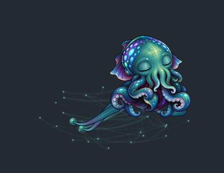

# Terminus

A sleepy, cheeky little cuttlefish who lives on your desktop, sprawled across an ephemeral graph. He floats above your applications, breathes, reaches into his network and sometimes leaves an inscription. One local core, many views into the same life.

Terminus learns patterns of events, gets used to repetition, shifts his attention and occasionally leaves inscriptions in a fictional ancient-looking language. He is not a task assistant, chatbot or progression game. His graph is part of his associative memory, not a decorative network animation.



## Run

Python 3.10+; no GPU or cloud account required. With [uv](https://docs.astral.sh/uv/):

```sh
cd /home/eric/DocumentsFAST/Terminus
uv sync --extra test --extra desktop
uv run python scripts/desktopctl.py start
```

Terminus appears as a native transparent, frameless, always-on-top companion. The graph travels with him; its branches fade, bloom and carry pulses while his tendrils rest on and reach toward them. He blinks, peers, stretches, yawns, curls and makes deliberate excursions along the monitor's edges. Touch and dragging have a soft springy response. Long naps include little gestures and occasional short surveys. Empty transparent space is click-through. Hover or right-click for controls; there is no permanent panel behind him.

```sh
uv run python scripts/desktopctl.py status
uv run python scripts/desktopctl.py stop
```

To restore him automatically after crashes and login, install the user services once:

```sh
uv run python scripts/servicectl.py install
```

Both processes then restart automatically, with watchdogs for frozen event loops. Existing launcher commands control the services after installation. [Startup, recovery, logs and intentional stopping](docs/SERVICE_RECOVERY.md).

Stopping the desktop body leaves his organism core and learned memory running. Right-click the creature for **Pause roaming**, **Reduced motion**, **Look** (Automatic/Left/Right), **Notice windows and typing**, size, monitor and reposition controls, the observatory, or **Quit**. A normal drag places him on your desktop with directional swimming and a soft landing; Alt-drag moves him within his shared graph; a click pokes him. Roaming pauses while you handle him. Size, placement, facing and motion preferences survive a restart. **Living skin** adds procedural shimmer, travelling color cascades, cuttlefish camouflage and a deep crimson display over the existing GIFs, with protected eyes. Automatic blends them with rest, attention, movement and touch; manual styles and Off are available. [How the skin works](docs/LIVING_SKIN.md).

The web view at **http://127.0.0.1:8769** is an optional observatory and phone body. Pair other browsers using **Pair from token file** and choose `.local/token`, or run `uv run python -m terminus token` in your own terminal. The token stays out of browser storage and URLs.

Without uv, create a virtual environment and install `python -m pip install -e '.[test,desktop]'`, then replace `uv run python` with that environment's `python`.

The core creates `.local/organism.sqlite3`, a private pairing token and a single-writer lock. This directory contains your creature's history and learned state: keep it between runs and back it up while the core is stopped. It is excluded from Git. The initial organism has random model weights and an unobserved starting graph; it is not pretrained on your activity.

## Interact

Click/tap the creature to poke him. Drag him to another part of the graph. Open the observatory to introduce an explicit context, inspect recent events or opt into learning diagnostics. A reaction may be subtle or delayed. Glyphs have internal semantic structure but the habitat does not translate them.

To run the same native body in the foreground for development:

```sh
uv run python desktop/overlay.py
```

The native body and web observatory share the same organism, rather than simulating separate pets. The desktop shell is PyQt5 and depends on a working graphical session. See [desktop/README.md](desktop/README.md) for limitations and a noninteractive smoke test.

## Give him an environment

The desktop contributes coarse time and observations of its own visible habitat. On X11, **Notice windows and typing** also lets him look toward the active window or an available accessible text anchor, occasionally perch beside a window, and imitate typing with his tentacles. It reads window geometry and aggregate activity, never typed text, titles or screenshots. The menu toggle or `--no-awareness` disables these observations. See [desktop awareness boundaries](docs/DESKTOP_AWARENESS.md).

The browser contributes presence and deliberate interactions while it is open. Habitat visibility does not mean its human is active. A separate opt-in metadata collector can run on a personal computer:

```sh
# Coarse time/presence only
uv run python agents/collector.py

# Explicit project edit/commit signals and X11 app-class transitions
uv run python agents/collector.py --repo /path/to/a/repository --focus

# Introduce one context without a GUI
uv run python agents/collector.py --send 'mapping work'
```

The collector sends short labels and counts, never screen images, keystrokes, window titles, file contents or terminal command strings. `--focus` needs X11 and `xprop`; it is unavailable on native Wayland. Collector outboxes are bounded to 256 events / 24 hours; web action buffers have their own shorter bounds. Stable event IDs allow retries without teaching twice while retained in the core's dedup window.

## Phone / another device

Use the responsive web habitat from a reachable private **HTTPS** endpoint backed by this same core, then pair that browser with the same local token. Install/add to home screen where supported. The service worker caches the app and last view for an explicitly disconnected, read-only habitat; there is no second brain on the phone. Explicit actions may queue briefly for reconnect.

The core defaults to loopback. An intentional private-network bind requires `--host <private-interface> --allow-network`; authentication remains required. Use a private HTTPS reverse proxy or an existing Tailscale HTTPS setup for remote clients. This repository does not open firewall ports, create public ingress or provision a tunnel. Secure-context install/offline features are browser-dependent. Native phone sensors, widgets, live wallpaper and system-wide overlays are future platform-specific work.

## Verify

```sh
uv run python -m pytest -q
uv run python desktop/overlay.py --smoke-test  # running core; offscreen automatically when requested
node --check web/app.js
node --check web/service-worker.js
node --test tests/*.test.mjs
uv run python scripts/evaluate.py
```

Tests cover controlled online prediction learning, habituation, graph updates, exact restart continuity, single-authority locking, event deduplication, auth/origin boundaries, concurrent WebSockets, bounded outboxes and native interaction/network boundaries. A learned repeating test sequence is evidence of predictor learnability; it is not evidence of semantic understanding or long-term creature intrigue.

## Build notes

- [Concept and source chats](docs/CONCEPT.md)
- [Architecture, current boundaries and next extensions](docs/ARCHITECTURE.md)
- [Startup services and crash/freeze recovery](docs/SERVICE_RECOVERY.md)
- [Behavior, physical vocabulary and continuity](docs/ETHOLOGY.md)
- [Directional flight, window awareness and typing](docs/DESKTOP_AWARENESS.md)
- [GIF loops, transitions and local frame authoring](docs/GIF_ANIMATION.md)
- [Procedural living skin and protected eyes](docs/LIVING_SKIN.md)
- [Art sources, exact prompts and local diffusion workflow](docs/ART.md)
- [Verification record](docs/VERIFICATION.md)

The supplied original GIFs and video remain intact in `web/assets/`; downloaded source files outside the project were left untouched. The body preserves Terminus's identity and cute, cheeky, androgynous, subtly masculine eyes. Native motion plays actual transparent GIF loops with short GIF transitions, while code-drawn tendrils connect the body to the live graph. Approved PNG poses remain the authoring sources and fallback art. [GIF authoring](docs/GIF_ANIMATION.md); [art and exact prompts](docs/ART_DIRECTIONAL.md).
