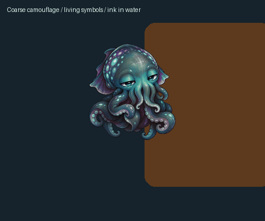

# Terminus

A small cuttlefish who lives on your desktop and minds his own business. Mostly.


He naps on a glowing graph, reaches toward things that hold his attention, and sometimes wanders off to inspect a corner of the screen. His eyes can follow the pointer, study a graph node, or settle into a private little stare. Carry him around and he swims. His skin shifts through shimmer, moving bands of color, camouflage and a deep red display. A sustained spell of typing can wake him; a pause can send him out for a small look around. He occasionally leaves a few signs in a made-up language.

There is a little learning behind it. Repeated events become familiar. A small recurrent model learns short event patterns, and connections in the graph influence where his attention goes. He keeps that history between runs. The animations give those changes a body.

## Install

Windows 10/11, macOS and Linux are supported. You need Git, Python 3.10 or newer, and [uv](https://docs.astral.sh/uv/getting-started/installation/). The native body uses Qt 6 hardware graphics: Direct3D 11 on Windows, Metal on macOS and OpenGL on the tested Linux desktop. No model download or cloud inference account is needed.

```sh
git clone https://github.com/Esemianczuk/Terminus.git
cd Terminus
uv run python scripts/setup.py
```

On Windows, `py -m pip install --user uv` installs uv, and `py -m uv run python scripts/setup.py` works even when its executable is not on PATH.

The installer builds a local environment, starts his core and desktop body, sets up login startup and recovery, and adds **Bring Back Terminus** to your desktop. Windows uses interactive Task Scheduler jobs, macOS uses launch agents, and Linux uses systemd user services. Each runs as your desktop user. [Setup instructions for each OS, updates and memory connectivity](docs/SETUP.md).

To try him before installing services:

```sh
uv sync --frozen --extra desktop
# First terminal:
uv run python -m terminus serve
# Second terminal:
uv run python desktop/overlay.py
```

The desktop needs a logged-in graphical session. Windows observes pointer position and window geometry; typing rhythm and sampled background colors are not implemented there yet. X11 can notice window bounds, pointer movement and aggregate typing. On macOS, window and pointer metadata work without text access; typing rhythm is available only when Input Monitoring permission was already granted. An explicit menu command can request that permission; startup never prompts. Native Wayland awareness is not implemented. Linux can also notice that an audio application has a microphone stream open, without opening a microphone or recording audio.

His body runs on Qt Quick's portable graphics layer. The artwork is packed with motion fields computed ahead of time, so adjacent poses can flow into each other while skin colors move independently. The same scene and shader assets give a future Android or iPhone version somewhere to start. There are no native mobile apps yet; other devices can use the browser habitat.

## Living with him

Click to give him a nudge. Drag to carry him. Right-click for size, movement, facing and skin controls. Empty space around him lets clicks pass through to your other windows.

The desktop window does not accept keyboard focus. Its optional observer runs in a separate process and reports small, bounded summaries. Depending on the OS, it notices aggregate typing rhythm, pointer movement and window geometry. It never reads typed characters, key identities, window titles, clipboard contents or audio. Turn **Notice windows and typing** off in the menu to stop that observation. Waking visits and little excursions have time limits and cooldowns, so a busy day still leaves room for naps.

**Living skin → Match colors behind me** is a separate, optional visual sensor. It samples the background beneath him and immediately reduces it to four colors. The colors ease into his camouflage, preserving the painted light, texture and eyes. On macOS this needs Screen Recording permission; **Allow screen colors...** opens the system request. X11 uses the compositor's existing window images and leaves input alone. These temporary pixels and colors are never saved, sent to the core, uploaded, or used for learning. Turning the option off discards them.

His skin can also dissolve partly into ASCII, or become a whole little creature made of symbols with his eyes still intact. Occasionally he lets out an ink cloud. It curls and thins over several seconds, with currents influenced by nearby window edges and motion. Move a window beneath him and the cloud responds. **Release an ink cloud** lets you try it; **Reduced motion** suppresses it. The fluid is a bounded procedural shader, so it needs no simulation grid or growing trail of particles.

**Bring Back Terminus** checks both services and restores him if needed. Background checks also recover stopped or frozen processes. An explicit Quit or stop is respected until you bring him back.

The graph shows memory contexts and their associations. Brighter nodes are active; stronger connections draw more clearly. One tentacle follows attention and others find supporting nodes. Reaches linger before settling back, and the graph eases into changes with him. The moving lights express activity on those connections. Each connection keeps its own continuous travel phase, so a burst of activity brightens the flow without teleporting it. Their exact timing is animation, not a literal trace of each calculation. His body can bank and turn while the graph stays upright.



His state lives in `.local/`, outside Git. Keep that folder. Updating the source does not give you a new creature.

## Update a machine

From its checkout:

```sh
uv run python scripts/update.py
```

This backs up the local memory database, pulls GitHub with `--ff-only`, rebuilds dependencies and restores the services. It refuses to discard local source changes. Each computer can update independently. To enable hourly checks, run `uv run python scripts/update.py --enable-auto`. `--status` shows the last result and `--disable-auto` turns them off. Bank-only and documentation-only updates do not restart him. Automatic source updates are off by default.

For service status:

```sh
uv run python scripts/servicectl.py status
```

[Startup, recovery and stopping](docs/SERVICE_RECOVERY.md)

## A shared memory bank

Each computer has its own creature, private model and history. There is also an optional public model that they can learn from together.

Think of this as sharing learned tendencies. A small network adjusts numerical connections when categories of events recur in an order. Those connections are a black box that can influence what draws his attention and which reactions become familiar. The bank is not a diary of your desktop and does not contain a searchable collection of things people typed. It is also not an LLM or a claim that he understands what you are doing.

That second model receives only seven fixed event categories: `context`, `poke`, `drag`, `presence`, `git`, `activity` and `time`. It never receives the context strings, typed characters, passwords, window titles, file contents, timestamps, geometry or event logs. Contributions contain small, clipped numerical changes to its 24-unit recurrent network.

```sh
# Pull the bank and learn locally, without uploading:
uv run python scripts/collective.py enable
uv run python scripts/collective.py sync

# Allow publishing with a GitHub account that can write to this repo:
uv run python scripts/collective.py enable --publish
```

Exchange runs about every ten minutes on all three operating systems. It is off until enabled. A creature needs at least 32 category observations before it can export an update. GitHub serializes and validates bank updates. The resulting model supplies a small attention prior; it never replaces either creature's private memory or neural weights.

Several personal machines can use one authenticated publisher through an SSH relay, or publish independently over HTTPS. [Connection options and exact commands](docs/SETUP.md#optional-shared-memory). Each keeps its own identity and private learning.

Anyone can inspect the [bank](community/bank.json), run a learner, or submit a contribution in a pull request. Reading the bank needs no GitHub login. Publishing needs an authorized account or a reviewed pull request. An offline creature keeps learning and waits until it can reconnect.

This format leaves out content by construction. It is not a formal differential-privacy guarantee, and broad activity patterns can influence the shared weights. [Format, contribution process and limits](docs/COLLECTIVE_MEMORY.md)

## Browser habitat

Open `http://127.0.0.1:8769` to see his wider graph, introduce a context or inspect learning. A browser on the same computer pairs automatically; there is no token to copy. The browser and desktop on one machine share that machine's core.

The API defaults to loopback and still uses an authenticated session cookie. Automatic pairing requires a same-origin browser request through a loopback connection to a loopback address. A core bound to a network interface still requires the private `.local/token` file for browser pairing. An SSH tunnel to a loopback-bound core appears local and inherits the tunnel's access, so only trusted users should be allowed to open one. Public collective learning does not expose the local API. Sharing one core with a remote browser is a separate, deliberate setup through a private HTTPS endpoint.

## What he learns

The private predictor begins with random weights and learns event sequences. It can pick up a pattern such as activity followed by a quiet interval; it does not receive the words you typed during that activity. Familiarity changes responses; associations shape attention; sleep replays retained experience. His temperament, motives, gestures and symbol grammar are designed behavior, with learning influencing their choices.

He does not understand your screen or read what you type. The optional four-color camouflage sensor belongs entirely to the renderer. He will not grow new abilities just by being left running. A controlled repeating-sequence test demonstrates basic prediction learning; longer-term character is something to watch develop.

## Development

```sh
uv sync --frozen --extra test --extra desktop
uv run python -m pytest -q
uv run python scripts/evaluate.py
node --test tests/*.test.mjs
```

The GIF above is a controlled preview from the native GPU renderer. Original art and animation sources are documented in [the art notes](docs/ART.md). The checked-in GPU assets are ready to use; rebuilding optical flow needs only the optional art tools, and happens outside the running creature. Runtime memory, keys and local configuration stay out of the repository.

[Architecture](docs/ARCHITECTURE.md) · [Renderer](docs/GPU_RENDERING.md) · [Behavior](docs/ETHOLOGY.md) · [Skin effects](docs/LIVING_SKIN.md) · [Eye gaze](docs/GAZE.md) · [Desktop awareness](docs/DESKTOP_AWARENESS.md)

## License

[MIT](LICENSE). The character artwork was generated and refined for this project; its source and prompts are retained with the art notes. Dependencies keep their own licenses. [Qt for Python / PySide6](https://doc.qt.io/qtforpython-6/) is available under LGPLv3, GPLv3 or a commercial license. Redistributing an application must meet the terms of the Qt modules and other dependencies it includes.
