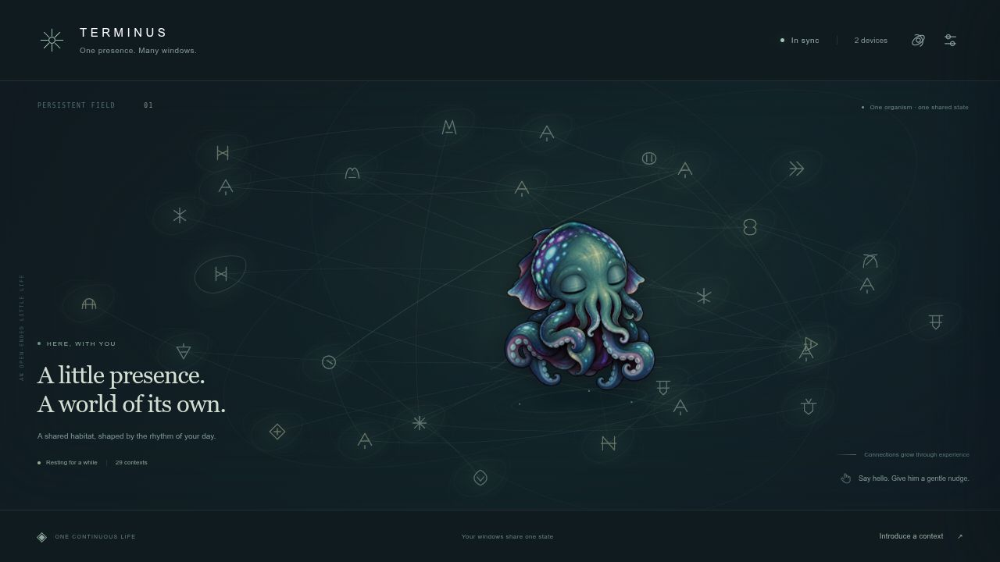

# Terminus

A sleepy, cheeky little cuttlefish organism living on a graph. One local core, many windows into the same life.

Terminus learns patterns of events, gets used to repetition, shifts his attention and occasionally leaves inscriptions in a fictional ancient-looking language. He is not a task assistant, chatbot or progression game. His graph is part of his associative memory, not a decorative network animation.



## Run

Python 3.10+; no GPU or cloud account required. With [uv](https://docs.astral.sh/uv/):

```sh
cd /home/eric/DocumentsFAST/Terminus
uv sync --extra test --extra desktop
uv run python -m terminus serve
```

For a managed background process, use `uv run python scripts/termctl.py start` instead of the foreground serve command. `status` and `stop` affect only the process started by this checkout.

Open **http://127.0.0.1:8769**. Pair using **Pair from token file** and choose `.local/token`, or run `uv run python -m terminus token` in your own terminal and paste the value into the pairing form. Pairing uses an HttpOnly cookie; the browser does not store the token in localStorage or the URL.

Without uv, create a virtual environment and install `python -m pip install -e '.[test,desktop]'`, then replace `uv run python` with that environment's `python`.

The core creates `.local/organism.sqlite3`, a private pairing token and a single-writer lock. This directory contains your creature's history and learned state: keep it between runs and back it up while the core is stopped. It is excluded from Git. The initial organism has random model weights and an unobserved starting graph; it is not pretrained on your activity.

## Interact

Click/tap the creature to poke him. Drag him to another part of the graph. Open the observatory to introduce an explicit context, inspect recent events or opt into learning diagnostics. A reaction may be subtle or delayed. Glyphs have internal semantic structure but the habitat does not translate them.

The native transparent desktop body uses the same core:

```sh
uv run python desktop/overlay.py
```

Ordinary dragging moves the window; Alt-drag moves Terminus in his shared graph; right-click opens the habitat or quits. The desktop shell is PyQt5 and depends on a working graphical session. See [desktop/README.md](desktop/README.md) for limitations and a noninteractive smoke test.

## Give him an environment

The browser contributes presence and deliberate interactions while it is open. A separate opt-in metadata collector can run on a personal computer:

```sh
# Coarse time/presence only
uv run python agents/collector.py

# Explicit project edit/commit signals and X11 app-class transitions
uv run python agents/collector.py --repo /path/to/a/repository --focus

# Introduce one context without a GUI
uv run python agents/collector.py --send 'mapping work'
```

The collector sends short labels and counts, never screen images, keystrokes, window titles, file contents or terminal command strings. `--focus` needs X11 and `xprop`; it is unavailable on native Wayland. Collector outboxes are bounded to 256 events / 24 hours; web action buffers have their own shorter bounds. Stable event IDs allow retries without teaching twice while retained in the core's dedup window.

## Phone / another device

Use the responsive web habitat from a reachable private **HTTPS** endpoint backed by this same core, then pair that browser with the same local token. Install/add to home screen where supported. The service worker caches the app and last view for an explicitly disconnected, read-only habitat; there is no second brain on the phone. Explicit actions may queue briefly for reconnect.

The core defaults to loopback. An intentional private-network bind requires `--host <private-interface> --allow-network`; authentication remains required. Use a private HTTPS reverse proxy or an existing Tailscale HTTPS setup for remote clients. This repository does not open firewall ports, create public ingress or provision a tunnel. Secure-context install/offline features are browser-dependent. Native phone sensors, widgets, live wallpaper and system-wide overlays are future platform-specific work.

## Verify

```sh
uv run python -m pytest -q
uv run python desktop/overlay.py --smoke-test  # running core; offscreen automatically when requested
node --check web/app.js
node --check web/service-worker.js
node --test tests/*.test.mjs
uv run python scripts/evaluate.py
```

Tests cover controlled online prediction learning, habituation, graph updates, exact restart continuity, single-authority locking, event deduplication, auth/origin boundaries, concurrent WebSockets, bounded outboxes and native interaction/network boundaries. A learned repeating test sequence is evidence of predictor learnability; it is not evidence of semantic understanding or long-term creature intrigue.

## Build notes

- [Concept and source chats](docs/CONCEPT.md)
- [Architecture, current boundaries and next extensions](docs/ARCHITECTURE.md)
- [Art sources, exact prompts and local diffusion workflow](docs/ART.md)
- [Verification record](docs/VERIFICATION.md)

The supplied original GIFs and video remain intact in `web/assets/`; downloaded source files outside the project were left untouched. The new body preserves Terminus's identity, removes the baked graph and refines his eyes toward cute, cheeky, androgynous and subtly masculine. High-resolution art uses procedural visual motion; a full independent skeletal/mesh rig is a later refinement.
