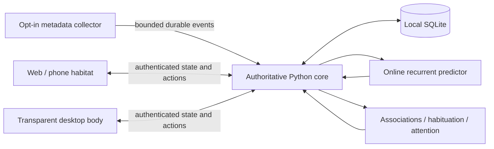

# Architecture

## Continuity

The Python service owns organism identity, clock, stochastic state, recurrent weights, graph, inscriptions and position. SQLite stores snapshots and a bounded event history. A seed allows reproducible tests; persisted RNG state and learned weights preserve continuity across restart. Ticking updates internal dynamics even when no client is connected. A renderer may animate breathing between updates but cannot choose a new behaviour independently.

Every accepted event has a stable client-generated ID. Deduplication prevents a retried event from teaching twice. WebSocket snapshots contain a monotonic revision. Phone and desktop rendering are views of the same organism, with layouts adapted to screen size.

The initial structural scaffold is an explicit prior: edges are marked `origin: scaffold`. Accepted experience adds `origin: learned` associations. Actual edge weights propagate activation and affect attention. Scaffold migration preserves existing learned weights, memory and identity; a scaffold is never counted as learned experience.

## Learning

A compact NumPy recurrent predictor learns the next event class/context bucket from previous events using online gradients. No GPU, pretrained model, cloud API or inference bill is required. Cold-start metrics are exposed in the optional inspector. Associative edges learn co-occurrence and transitions; familiarity reduces surprise from repetition. Sleep consolidation replays retained experience. The explicit stochastic policy combines those signals with latent restfulness, curiosity, agitation, focus and symbolic pressure.

This does not claim semantic comprehension of screen content. The default sensors do not capture screens, keystrokes, file contents or terminal command strings.

## Storage and access

Runtime data and the generated local pairing token live in `.local/`, ignored by Git. Bearer authentication supports native clients and collectors; browser pairing exchanges the token for a same-site cookie. Browser mutation and socket origins are checked. The local service defaults to loopback. Remote use is deliberate: bind an appropriate private interface and put HTTPS in front of it, for example with an existing private Tailscale setup. The project does not configure public ingress or change a firewall.

The web client retains a last snapshot for an explicitly labelled disconnected view. Its bounded event outbox contains explicit user actions; it never simulates a second organism or fabricates incoming activity. The collector maintains its own bounded SQLite outbox with stable IDs and expiry.

## Sensor boundaries

`agents/collector.py` sends coarse time and presence by default. `--focus` opts into X11 WM_CLASS changes without titles. `--repo /path` opts a Git root into commit-change and tracked-file edit-count signals. Paths and contents stay on the collector; the core receives a short project label. Wayland app focus is not implemented. Platform-specific phone sensors are not included; the responsive web client contributes presence and deliberate interactions while open.

## Rendering

The full habitat renders actual graph nodes and edges. Activation controls pulses; attention and shared state control posture, colour, tendrils and sparse glyphs. The body is an alpha image with procedural visual motion; supplied animated GIFs remain available as source references. A PyQt5 transparent window supplies a lightweight desktop body. Native window dragging is distinct from moving Terminus within his shared graph.

## Next extensions

- A segmented 2D mesh or skeletal rig with independently animated eyes, mantle and tentacles, derived from the approved body design.
- Optional local Stable Diffusion asset studies, using the included art prompts and identity constraints, without generation in the runtime loop.
- Native mobile packaging and opt-in phone event collectors; app/widgets/live wallpapers depend on OS capabilities.
- Longer fixed-sequence replay comparisons and a multiweek observation study of learned behavioural predictability versus seeded controls.
