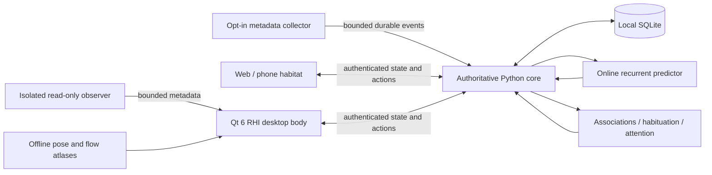

# Architecture

## Continuity

The Python service owns organism identity, clock, stochastic state, recurrent weights, graph, inscriptions, position, temperament, motives, finite gestures and motion intent. SQLite stores snapshots and a bounded event history. A seed allows reproducible tests; persisted RNG state and learned weights preserve continuity across restart. Ticking updates internal dynamics even when no client is connected. A renderer interpolates physical expression between updates; it cannot choose a new core behavior independently. Schema 3 adds ethology without consuming the old random stream or replacing learned weights.

Every accepted event has a stable client-generated ID. Deduplication prevents a retried event from teaching twice. WebSocket snapshots contain a monotonic revision. Phone and desktop rendering connected to one core are views of the same organism, with layouts adapted to screen size. Each installed computer starts an independent organism with a fresh identity.

The initial structural scaffold is an explicit prior: edges are marked `origin: scaffold`. Accepted experience adds `origin: learned` associations. Actual edge weights propagate activation and affect attention. Scaffold migration preserves existing learned weights, memory and identity; a scaffold is never counted as learned experience.

## Learning

A compact NumPy recurrent predictor learns the next event class/context bucket from previous events using online gradients. No GPU, pretrained model, cloud API or inference bill is required. Cold-start metrics are exposed in the optional inspector. Associative edges learn co-occurrence and transitions; familiarity reduces surprise from repetition and partly recovers after absence. Sleep consolidation replays actual retained experience. The explicit stochastic policy combines those signals with latent restfulness, curiosity, agitation, focus, symbolic pressure and slow motives. Attention lingers and revisits learned associations. See [ETHOLOGY.md](ETHOLOGY.md) for the causal boundaries.

This does not claim semantic comprehension of screen content. The default sensors do not capture screens, keystrokes, file contents or terminal command strings.

## Optional collective learning

A separate 24-unit recurrent model learns only the seven fixed event categories. It never receives private contexts, text, timestamps or the private predictor's activations. After at least 32 observations it can release a clipped, quantized parameter delta. GitHub serializes validated contributions into a public bank. Clients exchange about every ten minutes, with a local process lock and a newest-round cache for offline continuity.

The locally adapted public model adds a small category prior to attention scores. It does not overwrite the private model or event history. Computers remain separate learners; an optional SSH relay carries only validated contribution packets. See [COLLECTIVE_MEMORY.md](COLLECTIVE_MEMORY.md) for the schema and privacy limits.

## Storage and access

Runtime data and the generated local pairing token live in `.local/`, ignored by Git. Bearer authentication supports native clients and collectors. A same-origin browser talking to the loopback-bound core receives a signed session cookie automatically; a network-bound core still requires token pairing. An SSH tunnel can make a remote browser appear local to the core, so tunnel access is part of this trust boundary. Browser mutation and socket origins are checked. The local service defaults to loopback. Remote use is deliberate: bind an appropriate private interface and put HTTPS in front of it, for example with an existing private Tailscale setup. The project does not configure public ingress or change a firewall.

The web client retains a last snapshot for an explicitly labelled disconnected view. Its bounded event outbox contains explicit user actions; it never simulates a second organism or fabricates incoming activity. The collector maintains its own bounded SQLite outbox with stable IDs and expiry.

Accepted events and their resulting state commit immediately in one transaction. Idle dynamics checkpoint every 15 seconds and on clean shutdown, reducing disk writes. Checkpoint failures retry with bounded logging; health becomes degraded. Tick exceptions roll back coherently. A backward wall clock reports blocked progress until time catches up. WebSocket registration and sends have bounded cleanup, including an initial-send timeout. Clients receive runtime status and freeze autonomous motion on stale or degraded state.

Events preserve observation and receipt times. Historical observations cannot claim current presence or move/wake the organism. Reordered inputs and large time gaps cannot teach false adjacent recurrent transitions. Recent direct manipulation can still respond physically without rewinding the learned sequence.

## Sensor boundaries

`agents/collector.py` sends coarse time and presence by default. `--focus` opts into X11 WM_CLASS changes without titles. `--repo /path` opts a Git root into commit-change and tracked-file edit-count signals. Paths and contents stay on the collector; the core receives a short project label. Wayland app focus is not implemented. Platform-specific phone sensors are not included; the responsive web client contributes presence and deliberate interactions while open.

The native body's separately switchable desktop awareness runs in a disposable process, with a worker-owned XCB/XInput2 connection on Linux or read-only CoreGraphics queries on macOS. The GUI reads only a bounded, validated cache. A stalled child becomes unavailable and is terminated without blocking the GUI or retrying indefinitely. The observer has no API for grabbing or injecting input, activating applications, requesting accessibility permission or opening audio streams. The earlier AT-SPI text-anchor helper is retired.

X11 supplies active-window geometry, pointer motion and aggregate raw-keypress counts without key identities. Mac window information is an approximation from normal on-screen window rectangles, not an accessible text control. Mac typing pulses come only from aggregate idle-time queries after an existing Input Monitoring grant passes a read-only preflight check; startup never requests that grant, while the explicit menu command can open the system request. Linux can query `pactl` source-output metadata for microphone use. It never opens a recording source, and Mac microphone-use detection is unavailable. No titles, screen pixels, typed text or audio enter the observer cache. Native Wayland observation is unsupported.

Geometry stays in the renderer. The core receives only five fixed `activity` contexts (`typing`, `typing-pause`, `pointer`, `microphone`, `desktop`), observation time and coarse intensity, under a shared passive-event budget. These actual observations can form private graph associations and predictor transitions. Only fresh sustained typing or microphone-use cues can invite a waking visit; passive pointer and desktop cues do not wake or move him. Activity visits have a ninety-second maximum, a forty-five-second wake cooldown and finite interludes after pauses. Gap interludes are separated by at least seventy-five seconds. Stale observations and expired deadlines cannot reenact past activity. The public learner receives only the broad event kind `activity`, not these contexts or geometry. [Exact boundaries](DESKTOP_AWARENESS.md) and [behavior](ETHOLOGY.md).

The independent opt-in background worker samples compositor pixels below the body and reduces them immediately to four colors. Its request/reply protocol carries only a request ID, availability and twelve RGB numbers. Pixels are released inside the worker; colors stay in the renderer and never reach the core or collective learner. Platform permissions and failure behavior are documented in [Desktop awareness](DESKTOP_AWARENESS.md).

## Rendering

The full habitat renders actual graph nodes and edges. Activation controls pulses; attention and state control posture, color, tendrils and sparse glyphs. The desktop is a PySide6 native window containing a Qt Quick scene. Its Rendering Hardware Interface selects a supported graphics API, including Metal on macOS and OpenGL on X11. The scene and baked shader package are portable building blocks for a future mobile shell; native Android and iOS applications are not included.

Source GIFs retain the approved key poses, explicit timing, graph anchors and finite sequence vocabulary. Offline tools compute bidirectional optical flow, displacement bounds, confidence and registered eye masks, then pack immutable PNG atlases. The live body reads playback metadata and supplies phase, clip rectangles and bounded uniforms to a GPU fragment shader. It warps adjacent poses, blends them and adds procedural skin coloration outside the eye guards. There is no runtime optical-flow calculation, diffusion model or NumPy per-frame shading. Facing instantly mirrors the whole body. The GPU path does not populate the complete decoded GIF cache; a selected clip's source alpha supports a bounded hit-mask cache instead.

Graph nodes, curves, pulses, tendrils and inscriptions are scene-graph items. Native hit testing uses source alpha and local vector curves at low frequency, with no GPU framebuffer readback. X11 applies an input-only window shape independently of the GPU surface; failure selects raster rendering. Cocoa mouse transparency follows the same local region. The top-level native window and GPU child do not accept keyboard focus. The observer and renderer cannot train a second model or manufacture observations. View motion follows finite core intent and stays bounded by the monitor and interaction state.

Quiet sleep is paced at four updates per second, quiet wakefulness at eight, gestures and roaming at about fifteen, and direct handling at up to twenty. Reduced motion holds a static pose and material. Stale or degraded core state freezes effect and animation time. Missing hardware, shader errors or unavailable native input shaping select a simpler cached-sprite raster renderer. A private startup marker latches this fallback after repeated early GPU exits; a fifteen-second visible, connected, actually rendered interval clears a successful startup marker. Fallback leaves core identity, learning and memory untouched. [Rendering details](GIF_ANIMATION.md), [skin](LIVING_SKIN.md) and [recovery](SERVICE_RECOVERY.md).

View preferences persist privately, separately from the organism. Linux user services and macOS launch agents supervise only this checkout's processes, verify exposed/connected native presence and preserve explicit pause markers.

## Next extensions

- A full anatomical skeletal rig and more registered expressions derived from the approved body design.
- Optional local Stable Diffusion asset studies, using the included art prompts and identity constraints, without generation in the runtime loop.
- Native mobile packaging and opt-in phone event collectors; app/widgets/live wallpapers depend on OS capabilities.
- Longer fixed-sequence replay comparisons and a multiweek observation study of learned behavioural predictability versus seeded controls.
