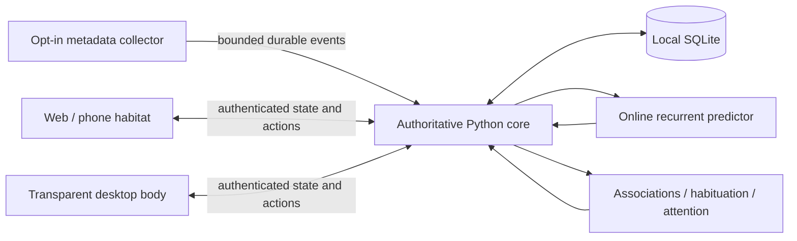

# Architecture

## Continuity

The Python service owns organism identity, clock, stochastic state, recurrent weights, graph, inscriptions, position, temperament, motives, finite gestures and motion intent. SQLite stores snapshots and a bounded event history. A seed allows reproducible tests; persisted RNG state and learned weights preserve continuity across restart. Ticking updates internal dynamics even when no client is connected. A renderer interpolates physical expression between updates; it cannot choose a new core behavior independently. Schema 3 adds ethology without consuming the old random stream or replacing learned weights.

Every accepted event has a stable client-generated ID. Deduplication prevents a retried event from teaching twice. WebSocket snapshots contain a monotonic revision. Phone and desktop rendering are views of the same organism, with layouts adapted to screen size.

The initial structural scaffold is an explicit prior: edges are marked `origin: scaffold`. Accepted experience adds `origin: learned` associations. Actual edge weights propagate activation and affect attention. Scaffold migration preserves existing learned weights, memory and identity; a scaffold is never counted as learned experience.

## Learning

A compact NumPy recurrent predictor learns the next event class/context bucket from previous events using online gradients. No GPU, pretrained model, cloud API or inference bill is required. Cold-start metrics are exposed in the optional inspector. Associative edges learn co-occurrence and transitions; familiarity reduces surprise from repetition and partly recovers after absence. Sleep consolidation replays actual retained experience. The explicit stochastic policy combines those signals with latent restfulness, curiosity, agitation, focus, symbolic pressure and slow motives. Attention lingers and revisits learned associations. See [ETHOLOGY.md](ETHOLOGY.md) for the causal boundaries.

This does not claim semantic comprehension of screen content. The default sensors do not capture screens, keystrokes, file contents or terminal command strings.

## Storage and access

Runtime data and the generated local pairing token live in `.local/`, ignored by Git. Bearer authentication supports native clients and collectors; browser pairing exchanges the token for a same-site cookie. Browser mutation and socket origins are checked. The local service defaults to loopback. Remote use is deliberate: bind an appropriate private interface and put HTTPS in front of it, for example with an existing private Tailscale setup. The project does not configure public ingress or change a firewall.

The web client retains a last snapshot for an explicitly labelled disconnected view. Its bounded event outbox contains explicit user actions; it never simulates a second organism or fabricates incoming activity. The collector maintains its own bounded SQLite outbox with stable IDs and expiry.

Accepted events and their resulting state commit immediately in one transaction. Idle dynamics checkpoint every 15 seconds and on clean shutdown, reducing disk writes. Checkpoint failures retry with bounded logging; health becomes degraded. Tick exceptions roll back coherently. A backward wall clock reports blocked progress until time catches up. WebSocket registration and sends have bounded cleanup, including an initial-send timeout. Clients receive runtime status and freeze autonomous motion on stale or degraded state.

Events preserve observation and receipt times. Historical observations cannot claim current presence or move/wake the organism. Reordered inputs and large time gaps cannot teach false adjacent recurrent transitions. Recent direct manipulation can still respond physically without rewinding the learned sequence.

## Sensor boundaries

`agents/collector.py` sends coarse time and presence by default. `--focus` opts into X11 WM_CLASS changes without titles. `--repo /path` opts a Git root into commit-change and tracked-file edit-count signals. Paths and contents stay on the collector; the core receives a short project label. Wayland app focus is not implemented. Platform-specific phone sensors are not included; the responsive web client contributes presence and deliberate interactions while open.

The native body's separately switchable desktop awareness uses a worker-owned XCB/XInput2 connection for active-window bounds and aggregate keyboard-activity headers. Optional event-only AT-SPI geometry comes from a bounded system-Python helper. Neither observer retrieves text or screen images. Coordinates stay local; only a rate-limited fixed `typing` activity cue reaches the core. A six-second authoritative imitation gesture remains gated by real fresh activity at render time. Unsupported platforms fall back to organism-only rendering. [Exact boundaries](DESKTOP_AWARENESS.md).

## Rendering

The full habitat renders actual graph nodes and edges. Activation controls pulses; attention and shared state control posture, colour, tendrils and sparse glyphs. A resident PyQt5 transparent window is the primary desktop body. It carries an ephemeral projection of actual graph edges and nodes, with tapered limbs that touch selected attention/activation nodes and no permanent panel. A continuous 2D texture mesh articulates the mantle and arms; registered key poses express blinking, rest, stretching and yawning. A shaped native input region lets empty space pass clicks through. Bounded window excursions follow core motion intent; view movement never trains a second model or emits synthetic activity. Native window dragging is distinct from moving Terminus within his shared graph. View preferences persist privately, separately from organism state. Render caches and adaptive frame scheduling reduce quiet-state work. `scripts/desktopctl.py` detaches and supervises only this checkout's native body, starts the core if needed, and checks exposed/connected native presence before claiming success.

## Next extensions

- A full anatomical skeletal rig and more registered expressions derived from the approved body design.
- Optional local Stable Diffusion asset studies, using the included art prompts and identity constraints, without generation in the runtime loop.
- Native mobile packaging and opt-in phone event collectors; app/widgets/live wallpapers depend on OS capabilities.
- Longer fixed-sequence replay comparisons and a multiweek observation study of learned behavioural predictability versus seeded controls.
