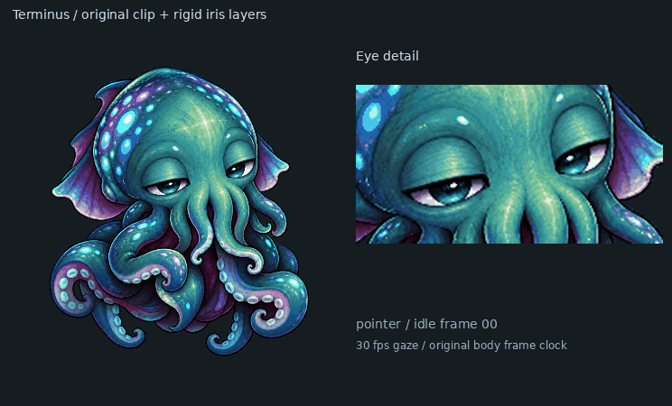

# Eye gaze

Terminus moves the eyes already painted in the approved source art. The original iris texture, white highlights, eyelid line, and blink images remain the source of truth. Runtime gaze is a small backward texture warp inside each visible eye opening. It does not paint a new iris or stretch the head.



`scripts/build_gaze_assets.py` contains two aperture outlines and iris centers for each open-eye source pose. These are the only hand annotations. The script builds soft motion fields, runs them through the same `FrameAuthor` mesh and blink overlay used to make the GIFs, and registers the results against all 129 decoded frames. It writes one small, opaque data texture per clip and a manifest with frame counts and GIF fingerprints. A visually closed blink has a zero field. The PNG source poses and GIFs are unchanged.

The raster desktop remaps only a small eye rectangle in the current frame. The GPU shader samples the same data texture after body optical-flow registration and before pigment shading. At zero gaze the original decoded pixels are preserved. Displacement fades to zero at the lid boundary. The body mirror, tilt, and user scale apply afterward to the entire image, so both eyes retain the same local coordinate system.

The gaze controller can watch a moving pointer when desktop awareness is enabled. It may also look toward the core's current graph attention, a focused window, somewhere nearby, or rest. Looking at a nearby screen point adds a slight inward shift to both irises; far points keep their axes almost parallel. This is a restrained screen-distance cue, not a depth camera or an inference about the contents of a window. Disabling desktop awareness removes pointer and window inputs. Reduced motion freezes eye movement.

To add a future source pose, give each open eye one aperture outline and iris center in `OPENINGS`. Closed poses need no annotations. Then regenerate the GIFs, skin atlas, gaze assets, GPU assets and shaders in that order:

```sh
uv run --extra art --extra desktop python scripts/build_animation_clips.py
uv run --extra art --extra desktop python scripts/build_skin_atlas.py
uv run --extra art --extra desktop python scripts/build_gaze_assets.py
uv run --extra art --extra desktop python scripts/build_gpu_assets.py
uv run --extra desktop python scripts/build_shaders.py
```

The build rejects an unannotated open source pose and a mismatched GIF clock. Runtime rejects mismatched texture fingerprints and falls back to the original eyes. No model training, screen capture, keyboard hook, or GPU readback is involved.
